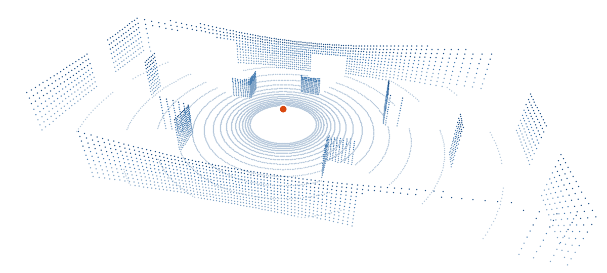

<picture>
  <source media="(prefers-color-scheme: dark)" srcset="./assets/telemetry-dark.svg">
  
</picture>

I'm **Charles Quan Tran**, an AI engineer in Brisbane, Australia. I work on robots that understand 3D space, and on getting more out of every GPU that runs the models.

**I'm looking for a Research Assistant role in 3D perception or HPC for AI.** The best way to reach me is [LinkedIn](https://www.linkedin.com/in/charlestrann).

The measurements behind the chart

 

Qwen3-8B served with vLLM 0.33.0 on one NVIDIA H100 80GB. Each value is the mean of three runs.

| Concurrent requests | BF16 tokens/s | FP8 tokens/s | BF16 J/token | FP8 J/token |
|---:|---:|---:|---:|---:|
| 1 | 146 | 223 | 3.117 | 1.866 |
| 16 | 2,034 | 3,044 | 0.248 | 0.150 |
| 64 | 6,483 | 9,146 | 0.099 | 0.059 |
| 256 | 12,398 | 16,432 | 0.054 | 0.039 |

Every run is in [`h100-qwen3-8b.csv`](./assets/h100-qwen3-8b.csv), and [`build_assets.py`](./scripts/build_assets.py) draws the chart from it.

## Research interests

**3D perception.** Building maps from LiDAR, locating a robot inside them, and navigating on what it sees.

**HPC for AI.** Throughput, latency and energy per token: what limits a GPU under real load, and which change removes the limit.

<picture>
  <source media="(prefers-color-scheme: dark)" srcset="./assets/lidar-dark.svg">
  
</picture>

Simulated 26-ring LiDAR scan, shaded by height, with the sensor in orange. Ray-cast by the script in this repository.

## Tools

| Area | Tools |
|---|---|
| **Robotics** | ROS 2, Nav2, SLAM, Gazebo, LiDAR, Jetson Nano, Raspberry Pi |
| **Inference and GPU** | vLLM, SGLang, TensorRT-LLM, NVML, FP8 and AWQ quantization |
| **AI engineering** | Python, PyTorch, TensorFlow, LangChain, RAG, Claude Code |
| **Systems** | Linux, Docker, Kubernetes, AWS, PostgreSQL |

## Background

- **Now:** freelance web apps, and game development for Steam
- **Before:** AI engineer and software engineer
- **Education:** Bachelor of Information Technology, Torrens University Australia, 2023–2025
- **Next:** planning a Master of Advanced Engineering at Monash University, Melbourne
